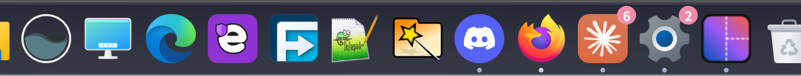

# Fogline · 霧線

[English](README.md) · [繁體中文](README.zh-TW.md)

A macOS-inspired desktop for **Windows 11 and Seelen UI**: a translucent menu bar, floating Dock, coordinated panels, a Spotlight-style search box. An independent community project, not an Apple product.




These screenshots illustrate the desktop; they are not a visual regression test for every current panel.

## Features

| Area | Included |
| --- | --- |
| Desktop | Shared light/dark materials, wallpaper accent support, rounded Dock, app indicators and icon magnification |
| Menu bar | App menu, foreground app, tray, input source, Bluetooth, network, search, Control Center, calendar and notifications; battery on supported devices |
| Control Center | Connectivity, media, monitor brightness, audio output, appearance, warm display and focus controls |
| Calendar | Lunar dates, ISO weeks, month/year navigation and cached public holiday data; Taiwan, Japan and additional countries supported by Nager.Date |
| Input | Installed keyboard layouts and IME state, with mode controls where the input method supports them |
| Connectivity | Wi-Fi through the native bridge; paired Bluetooth devices and on-demand discovery/pairing |
| Search | Fogline Lantern on `Alt + Space`: apps, open windows, files, settings, quick actions, calculator, units and the web; Seelen Apps Menu is the application drawer |
| Icons | Fogline artwork for Files, the native launcher, Settings and other shell entries |

## Install

Requirements: Windows 11, Seelen UI 2.8.x installed and run at least once. Noto Sans TC is recommended for Traditional Chinese; Noto Sans JP improves Japanese glyph selection. The installer compiles the native bridge with Windows' .NET Framework compiler. Node.js is only needed to rebuild widgets.

```powershell
git clone https://github.com/HsuanC0921/fogline.git
cd fogline
./install.ps1
```

The installer stops Seelen's watchdog and UI before writing files, installs resources, merges the recommended settings, replaces the menu-bar layout and restarts Seelen. Inspect [settings.example.json](settings.example.json) and [toolbar-layout.yml](toolbar-layout.yml) before applying this desktop configuration.

| Option | Effect |
| --- | --- |
| `-ThemeOnly` | Skip recommended settings/layout; still install Fogline resources and restart Seelen |
| `-PinSettings` | Also pin System Settings to the Dock |

Decide whether to allow requested Seelen widget capabilities yourself. Re-run the installer after changing Seelen's language to refresh toolbar tooltips. Windows' automatic accent-color option lets the theme follow the wallpaper accent.

## Lantern search

`Alt + Space` opens Fogline Lantern, a Spotlight-style box that runs only while it is open. It keeps **no index of its own**: apps come from the Start Menu list Seelen already maintains, open windows from Seelen's window list and files from Windows' own search index (through the native bridge, on demand). The only thing it stores is a small launch counter used to rank results.

| Type | Examples |
| --- | --- |
| Apps | `edge`; recently used apps appear when the box is empty; frequently used ones rank higher |
| Open windows | Type part of a title to switch to it; `quit telegram` closes it |
| Files | Windows Search results, newest first; `Ctrl + Enter` reveals the folder, `Ctrl + Shift + C` copies the path |
| Settings | `wifi`, `display`, `sound`, `update` … open the matching Settings page |
| Quick actions | lock, sleep, restart, shut down, sign out, Task Manager, Recycle Bin, dark/light mode, eye care, Do Not Disturb |
| Calculator and units | `2^10 + sqrt(16)`, `10 km to mi`, `20c to f`, `5 gb to mib` |
| Utilities | `uuid`, `now`, `#ff8800` (colour), `~\Downloads` or `C:\path` (open), `> ipconfig` (run in a console) |
| Web | `yt`, `gh`, `wiki`, `map` prefixes, any `domain.tld`, otherwise a web search |

`Alt + 1…9` activates a row. Results are grouped like Spotlight. Without the native bridge, file search is simply absent.

## Files and QuickLook

`./integrations/files/install.ps1` tints [Files](https://files.community/) and [QuickLook](https://github.com/QL-Win/QuickLook) with the same material as the panels. Files has no theme-file format any more, so the script only writes its sidebar, toolbar, address-bar and file-area colours (it closes Files first, then reopens it). For QuickLook it turns on `UseTransparency`, `WindowBackdrop` and `WindowBackgroundColor` in `QuickLook.config`. Colours follow the Windows mode at install time; re-run it after switching between light and dark, or pass `-Light`. Fonts and the backdrop material you chose in Files are left alone.

## Shortcuts and optional integrations

| Shortcut | Action |
| --- | --- |
| `Alt + Space` | Fogline Lantern |
| `Alt + Shift + Space` | Fogline app menu |

The installed toolbar layout is the source of truth for panel placement. Files, Everything and QuickLook are separate applications; this theme does not replace Explorer's shell process or guarantee QuickLook compatibility in every file manager.

The optional [mpv integration](integrations/mpv/README.md) provides a Traditional Chinese Modern Glass configuration based on akFace/mpv.config and per-user registration scripts. Install it separately from the desktop theme.

## Build and project layout

```powershell
npm ci
npm run build
```

Commit generated widget `index.js` files with their TypeScript sources. Bundling success does not prove native controls work on a particular machine.

| Path | Responsibility |
| --- | --- |
| `theme/shared.css` | Materials, colors, typography and shared panel styles |
| `theme/styles/` | Menu bar, Dock, context menus, tooltips and flyouts |
| `plugins/`, `toolbar-layout.yml` | Toolbar behavior and layout |
| `widgets/` | Panel sources and bundled assets |
| `native/` | Display, input, Wi-Fi and desktop integration bridge |
| `integrations/mpv/` | Optional player configuration and registration |

Read [AGENTS.md](AGENTS.md) before modifying an installation. Do not edit Seelen's persistent settings while its UI/watchdog can overwrite them.

## Limits and troubleshooting

- Brightness depends on monitor/driver support. IME controls depend on the input method; not every third-party IME supports direct switching.
- Warm display strength is adjustable from 0–100% through a collapsed control. Levels above 50% extend into a deeper amber. Dragging previews the transform; releasing saves the level for future sessions. The percentage is an effect strength, not a calibrated color temperature.
- Warm display is Fogline's Magnification color transform, separate from Windows Night light. HDR, protected content and exclusive fullscreen need device-specific verification.
- Appearance switching uses an undocumented Windows theme interface. Do Not Disturb uses IQuietHoursSettings directly, with active-profile readback; no Settings windows are opened. These undocumented COM interfaces can change with Windows updates.
- Holiday APIs have different coverage. Cached data remains available offline; missing years are not replaced with invented holidays.
- Notification actions use native Seelen activation, dismissal and reply commands. Some desktop toasts cannot be activated by third-party clients; they remain available with full text and a Windows Notification Center entry using direct Shell COM activation (not keyboard simulation). Windows Do Not Disturb is read through the native bridge; unavailable state is not replaced by a local-only success.
- Widget permissions, external menus and fullscreen behavior need testing on the target system. Hiding the native taskbar does not stop Explorer or eliminate background work.
- Seelen logs: `%LOCALAPPDATA%\com.seelen.seelen-ui\logs`.

## License

Original Fogline code and artwork: [MIT](LICENSE). Widget bundles include `@seelen-ui/lib`, licensed **AGPL-3.0-only**; bundled distribution must respect that license. The mpv integration retains its upstream notices and [LGPL license](integrations/mpv/LICENSE.LGPL). Native bridge notices: [native/THIRD-PARTY.txt](native/THIRD-PARTY.txt).
